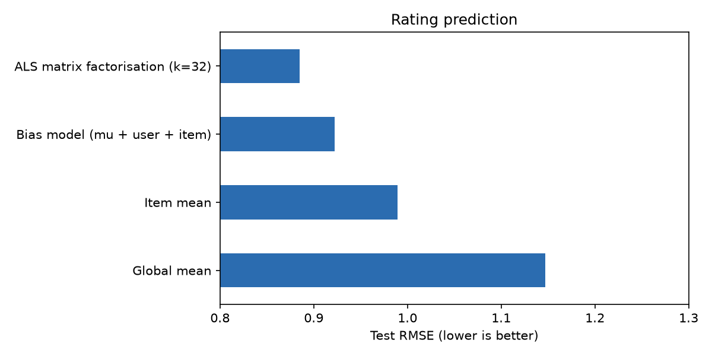
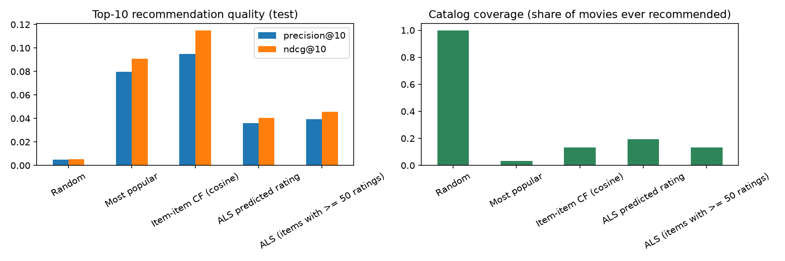

# Movie Recommender from Scratch (MovieLens 1M)

I build a recommender system with only numpy/scipy (no recommender library) and I evaluate it on **two different tasks**: predicting ratings and recommending a top-10 list.
The main lesson of the project: **the model that predicts ratings best is not the one that recommends best.**

## Data
MovieLens 1M (GroupLens): 1,000,209 ratings from 6,040 users on 3,706 movies (density 4.5%).

## Evaluation setup
- **Temporal split per user**: the last 20% of each user's ratings (by timestamp) are the test set (800,193 train / 200,016 test). A random split would let the model "see the future" of each user.
- Hyper-parameters are chosen on a validation slice taken from the end of the *training* data, never on the test set.
- Ranking task: recommend 10 movies the user has not rated in train. A recommendation is a hit if the user rated it **4 or 5** in the test period.

## Models
| Model | Idea |
|---|---|
| Global mean / item mean | Simple baselines |
| Bias model | `mu + user bias + item bias` with regularisation |
| **ALS matrix factorisation** | Learns a vector of 32 numbers per user and per movie, on the residuals of the bias model. Alternating Least Squares written by hand. |
| Most popular | Same top-10 for everybody (strong baseline in practice) |
| **Item-item collaborative filtering** | Cosine similarity between movies from who-watched-what. Score = sum of similarities to the movies the user already saw. |

## Results

### 1) Rating prediction (test RMSE, lower is better)
| Model | RMSE |
|---|---|
| Global mean | 1.147 |
| Item mean | 0.989 |
| Bias model | 0.922 |
| **ALS (k=32)** | **0.885** |

### 2) Top-10 recommendation (higher is better)
| Model | Precision@10 | Recall@10 | NDCG@10 | Catalog coverage |
|---|---|---|---|---|
| Random | 0.005 | 0.003 | 0.005 | 100% |
| Most popular | 0.080 | 0.047 | 0.091 | 3.2% |
| **Item-item CF** | **0.095** | **0.079** | **0.115** | 13.1% |
| ALS predicted rating | 0.036 | 0.021 | 0.041 | 19.5% |
| ALS, items with >= 50 ratings | 0.040 | 0.024 | 0.046 | 13.2% |




### What the results say
- ALS has the **best RMSE** but the **worst ranking** among the real models. It is trained to predict the exact rating, so it likes movies with a high predicted rating, often niche movies with few ratings. But users mostly watch what is popular, so these recommendations are rarely in the test set. Restricting ALS to movies with at least 50 ratings helps only a little.
- **Most popular is hard to beat**: it recommends the same 10 movies to everyone and gets a precision of 8%. Its **coverage is only 3.2%** of the catalog, so it is useless for discovery.
- **Item-item CF** is better than popularity on all ranking metrics (+19% precision, +66% recall, +27% NDCG) and recommends 4 times more different movies (13.1% coverage).
- Absolute precision looks low (9.5%) because only the last 20% of ratings are used as ground truth and many good movies were never rated by the user. The comparison between models is what matters.

### Example (user 1)
Loved recently: *Apollo 13*, *Mary Poppins*, *Ben-Hur*, *Dumbo*, *Schindler's List*.
Item-item CF recommends: *Star Wars: Episode V*, *Raiders of the Lost Ark*, *Groundhog Day*, *The Shawshank Redemption*, *Pulp Fiction*... Reasonable, but also very popular, which confirms the popularity bias.

## Limitations
- Offline metrics are only a proxy. The real test would be an online A/B test.
- I did not try ranking-oriented models (implicit ALS, BPR, a neural recommender), which are the logical next step given the results above.
- No cold start handling: new users or new movies without ratings get poor recommendations.
- The ALS convergence plot uses the test set only for display, not for any choice.
- MovieLens is old (2000-2003), so tastes and the catalog are not current.

## How to run
```bash
pip install -r requirements.txt
python src/recsys.py       # downloads data (about 6 MB), takes a few minutes
```

## Skills shown
Recommender systems, matrix factorisation (ALS implemented by hand), sparse matrices, temporal validation, ranking metrics (precision, recall, NDCG, coverage), popularity bias, critical reading of results.
